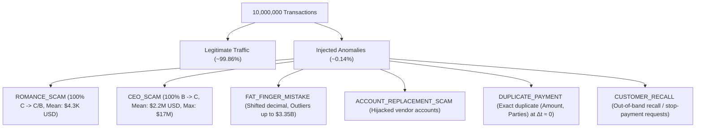

# UMDAC Datathon 2026 – Swift Cross-Border Payments Analytics

Official repository for the **Universiti Malaya Data Analytics Club (UMDAC) Datathon 2026** Preliminary Round challenge in collaboration with **SWIFT**.

---

## 📋 Table of Contents
1. [Competition Overview & Timeline](#competition-overview--timeline)
2. [The Challenge: Reverse-Engineering Swift's Synthetic Payment Engine](#the-challenge-reverse-engineering-swifts-synthetic-payment-engine)
3. [Dataset Architecture & Comprehensive Feature Dictionary](#dataset-architecture--comprehensive-feature-dictionary)
4. [Empirical Dataset Statistics & Anomaly Profiles](#empirical-dataset-statistics--anomaly-profiles)
5. [Dataset Packaging & Reassembly Guide](#dataset-packaging--reassembly-guide)
6. [Preliminary Round Submission Deliverables](#preliminary-round-submission-deliverables)
7. [Official Evaluation Rubric & Scoring Weights](#official-evaluation-rubric--scoring-weights)
8. [Reverse-Engineering Framework & Feature-Group Blueprints](#reverse-engineering-framework--feature-group-blueprints)
9. [High-Performance Data Processing Guide](#high-performance-data-processing-guide)
10. [Rules, Academic Integrity & Compliance](#rules-academic-integrity--compliance)

---

## 1. Competition Overview & Timeline

The **UMDAC Datathon 2026** is an international data analytics competition organised by the Universiti Malaya Data Analytics Club (UMDAC) in collaboration with SWIFT. The competition tests participants' ability to uncover underlying causal data generation mechanisms, reverse-engineer synthetic economic dynamics, and formulate actionable financial intelligence.

### Critical Deadlines & Milestones
* **Preliminary Round Commencement**: 13 November 2026 at 11:50 AM (UTC+8)
* **Preliminary Round Submission Deadline**: **19 November 2026 at 12:00 PM (UTC+8)** (Strict 144-hour sprint)
* **Online Workshop 1 (Data Science & Analytics)**: 17 November 2026 (Tuesday)
* **Finalist Announcement**: 28 November 2026 (Saturday)
* **Online Workshop 2 (Finalist Preparation)**: 30 November 2026 (Monday)
* **Physical Grand Final & Closing Ceremony**: 4 December 2026 (Friday) at the Faculty of Computer Science & Information Technology (FSKTM), Universiti Malaya, Kuala Lumpur.

---

## 2. The Challenge: Reverse-Engineering Swift's Synthetic Payment Engine

### The Context
Swift interconnects over 11,500 financial institutions, market infrastructures, fintechs, and corporate enterprises across 200+ countries and territories. Cross-border payments traversing the Swift network represent a **directed temporal pseudograph** where institutions (BICs) and customer accounts form vertices, and payment messages (MT103 / pacs.008) form directed edges with inter-dependent transactional features.

Due to global banking secrecy and data privacy mandates (GDPR), Swift distilled real-world payment traffic dynamics into a synthetic data generator written in Python using hard-coded business logic, the `Faker` library, and NumPy random distribution models.

### The Problem Statement
Participants must **reverse-engineer the underlying generating rules and causal logic** used to construct the dataset.

> **Key Rule Requirement**:
> Findings must be framed as explicit, testable causal rules rather than simple correlations:
> $$\text{Rule Structure: When [Condition } X\text{], [Target Feature } Y\text{] changes by [Factor } Z\text{] across [Segment } W\text{].}$$

*Note on Synthetic Boundaries*: Baseline properties (e.g., country populations, city geography, and Faker-generated entity names) are randomized for public release. The underlying **economic decision rules, routing behavior, clearing latency cut-offs, and anomaly injection mechanisms** follow strict causal logic.

---

## 3. Dataset Architecture & Comprehensive Feature Dictionary

The primary data file is `swift_umdac_datathon_2026_fictitious_payment_data.csv`:
* **Exact Total Records**: **10,000,000 payment instructions**
* **Total Physical CSV Lines**: 83,806,705 lines (due to embedded multiline formatting in party details and token strings)
* **Raw File Size**: 4,952,194,328 bytes (~4.95 GB)
* **Compressed ZIP Size**: 1,563,561,489 bytes (~1.56 GB)

### The 21 Features

| # | Column Name | Data Type | Description & Reverse-Engineering Relevance |
| :---: | :--- | :--- | :--- |
| 1 | `DISCLAIMER` | Text | Legal header / metadata disclaiming liability for fictitious data. |
| 2 | `EPOCH_SECONDS` | Integer | Unix timestamp in seconds. Used to analyze diurnal rhythms, business hours, weekend effects, and clearing cut-offs. |
| 3 | `CURRENCY_CODE` | Categorical | ISO 4217 code (EUR, USD, GBP, CHF, SGD, TRY, CNY, JPY, AUD, CAD, etc.). |
| 4 | `USD_AMOUNT` | Float | Transaction amount normalized to USD for cross-currency equivalence. |
| 5 | `ORDERING_BIC8` | String (8 char) | Sending institution BIC (4 bank + 2 country + 2 location). |
| 6 | `BENEFICIARY_BIC8` | String (8 char) | Receiving institution BIC. |
| 7 | `BIC8_PATH` | String | Semicolon-delimited chain of intermediary routing institutions (e.g., `0024TRI0;0380CNB0`). Gaps marked by `...`. |
| 8 | `TOTAL_DURATION` | Integer | Total elapsed payment settlement time in seconds from initiation to completion. |
| 9 | `CONTINUITY_QFLAG` | Binary (`Y`/`N`) | `Y` if full intermediary path is observable; `N` if route contains hidden intermediaries (`...`). |
| 10 | `CURRENCY_CONVERSION_COUNT` | Integer | Number of FX conversion steps along the routing path (0 = single-currency, $\ge 1$ = FX required). |
| 11 | `PARTICIPANT_COUNT` | Integer | Total number of financial institutions in the settlement path. |
| 12 | `TRANSACTION_TYPE_CODE` | Categorical | Routing mechanism: `Direct` (bilateral), `Indirect` (intermediaries), or `Covered` (MT202COV bank-to-bank settlement). |
| 13 | `ORDERING_ACCOUNT` | String | Anonymized synthetic account ID for the sender (`_FAKE_...`). |
| 14 | `BENEFICIARY_ACCOUNT` | String | Anonymized synthetic account ID for the recipient (`_FAKE_...`). |
| 15 | `ORDERING_DETAILS` | Free-text | Semi-structured remittance party information (name, address, postal code, country code, line breaks). |
| 16 | `ORDERING_TOKENS` | Tokenized Text | Engineered semantic pattern tokens (e.g., `<business:7>`, `<street:18>`, `<post_code:US:5>`, `<line_break:35>`). |
| 17 | `BENEFICIARY_DETAILS` | Free-text | Semi-structured recipient party details and remittance instructions. |
| 18 | `BENEFICIARY_TOKENS` | Tokenized Text | Engineered pattern tokens for beneficiary entity attributes. |
| 19 | `ORDERING_TYPE` | Categorical (`B`/`C`) | Sender classification: `B` (Corporate / Business) vs. `C` (Retail / Consumer). |
| 20 | `BENEFICIARY_TYPE` | Categorical (`B`/`C`) | Recipient classification: `B` (Corporate / Business) vs. `C` (Retail / Consumer). |
| 21 | `ANOMALY_TYPE` | Categorical (Label) | Ground-truth injection flag indicating synthetic fraud or operational errors. |

---

## 4. Empirical Dataset Statistics & Anomaly Profiles

Empirical profiling across the 10,000,000 records reveals key baseline properties and distinct anomaly footprints:

### Traffic Distributions
* **Transaction Types**: Direct (~63.2%), Indirect (~32.6%), Covered (~4.2%).
* **Ordering Entity Types**: Business `B` (~78.7%), Consumer `C` (~21.3%).
* **Beneficiary Entity Types**: Consumer `C` (~71.1%), Business `B` (~28.9%).
* **Top Settlement Currencies**: EUR (~32.1%), USD (~17.2%), GBP (~8.8%), CHF (~7.9%), SGD (~3.7%), CNY (~3.3%).
* **Route Continuity**: Observable `Y` (~92.4%), Obfuscated / Gap `N` (~7.6%).

### Ground-Truth Anomaly Profiles (`ANOMALY_TYPE`)



| Anomaly Type | Sender Archetype | Recipient Archetype | Routing Distribution | Sizing & Behavioral Signature |
| :--- | :---: | :---: | :--- | :--- |
| **`ROMANCE_SCAM`** | **100% `C`** | 77% `C`, 23% `B` | 54% Direct, 46% Indirect | Modest retail outflows (mean: \$4,351 USD; median: \$800–\$2,500). Recurring cross-border gifts/support. |
| **`CEO_SCAM`** | **100% `B`** | 88% `C`, 12% `B` | 56% Direct, 44% Indirect | Extreme values (mean: \$2,214,148 USD, up to \$16.9M USD). Spoofed executive instructions paying individual mule accounts. |
| **`FAT_FINGER_MISTAKE`** | 80% `B`, 20% `C` | 71% `C`, 29% `B` | 54% Direct, 32% Indirect, 14% Covered | Comma/period placement error multiplying amounts by $10^2$ to $10^3$ (mean: \$124.6M USD, max: **\$3.35 Billion USD**). |
| **`ACCOUNT_REPLACEMENT_SCAM`** | 56% `B`, 44% `C` | 56% `C`, 44% `B` | 81% Direct, 19% Indirect | Legitimate invoice intercepted; beneficiary account swapped to an unverified recipient (mean: \$146K USD). |
| **`DUPLICATE_PAYMENT`** | **100% `B`** | **100% `C`** | 100% Indirect | Exact duplicate tuples `(ORDERING_ACCOUNT, BENEFICIARY_ACCOUNT, USD_AMOUNT)` executed within seconds (race condition). |
| **`CUSTOMER_RECALL`** | **100% `B`** | 50% `B`, 50% `C` | 75% Direct, 25% Covered | Formal recall message following erroneous payment instruction. |

---

## 5. Dataset Packaging & Reassembly Guide

Due to GitHub's strict file size limit (maximum 2.00 GB per object in Git LFS), the 4.95 GB CSV is stored using two redundant, validated methods:

### Option A: Unzip the Archive (Recommended)
```bash
unzip swift_umdac_datathon_2026_fictitious_payment_data.zip
```

### Option B: Reassemble Multi-Part LFS Chunks
The CSV is partitioned into three chunks strictly under 1.7 GB:
* `swift_umdac_datathon_2026_fictitious_payment_data.csv.part_aa` (1.7 GB)
* `swift_umdac_datathon_2026_fictitious_payment_data.csv.part_ab` (1.7 GB)
* `swift_umdac_datathon_2026_fictitious_payment_data.csv.part_ac` (1.4 GB)

To reassemble the original 4.95 GB file with a single command:
```bash
chmod +x reassemble_csv.sh
./reassemble_csv.sh
```
Or directly via shell:
```bash
cat swift_umdac_datathon_2026_fictitious_payment_data.csv.part_* > swift_umdac_datathon_2026_fictitious_payment_data.csv
```

---

## 6. Preliminary Round Submission Deliverables

Participating teams must submit **two PDF deliverables** before **19 November 2026 at 12:00 PM**:

### Deliverable 1: Dashboard Suite (PDF Format)
* **Volume**: 5 to 15 dashboard pages (one page per feature group).
* **Format**: Exported from Looker Studio, Tableau, Power BI, or equivalent.
* **Requirements per Page**:
  * Clear header stating the reconstructed business rule.
  * At least one primary chart illustrating how the rule manifests in data.
  * Baseline / control group comparison.
* **Grading Criteria**: Effectiveness of Charts & Evidence (50%), Visual Clarity (35%), Correctness of Insights (15%).

### Deliverable 2: Presentation Slide Deck (PDF Format)
* **Volume**: 10 to 20 slides total.
* **Constraint**: **Maximum of 1 slide per feature-type group**.
* **Required Slide Structure**:
  1. Title & Team Overview
  2. Executive Summary (Headline Findings)
  3. Reverse-Engineering Methodology & Hypothesis Testing Framework
  4–11. Feature-Group Deep Dives (Rule statement, Dashboard chart, Real-world economic rationale, Counterfactual controls)
  12. Multi-Factor Causal Interaction Model
  13. Anomaly Detection Decision Matrix
  14. **Tested & Rejected Hypotheses** (critical for explanatory depth score)
  15. Synthetic Boundaries vs. Real-World Banking Dynamics
  16. Conclusion & Recommendations
* **Grading Criteria**: Methodology & Analytical Process (65%), Economic Explanations (20%), Overall Presentation Quality (15%).

---

## 7. Official Evaluation Rubric & Scoring Weights

Across both deliverables, marks are allocated across four core pillars:


### Detailed Sub-Criteria
1. **Insight Quality (45%)**:
   * *Rule Reconstruction Quality (12%)*: Stating exact preconditions, magnitude of change, and segment coverage.
   * *Explanatory Depth (14%)*: Distinguishing causality from correlation; rigorously evaluating confounding factors; reporting rejected hypotheses.
   * *Correctness of Rules (9%)*: Accuracy of recovered rules against Swift's true generator script.
   * *Task Understanding (5%)* & *Specificity (5%)*: Quantified, single-sentence headline claims.
2. **Evidence, Method & Data Integrity (23%)**:
   * *Method Appropriateness (8%)*: Using defensible, interpretable techniques (decision trees, regression, counterfactuals). Unnecessary black-box complexity is penalized.
   * *Empirical Proof (6%)* & *Data Integrity (6%)*: Honest axes, confidence intervals, correct Unix timestamp conversion to UTC/local hours.
   * *Responsible Data Use (3%)*: Strict adherence to provided data; APA citations for external reference statistics.
3. **Communication (20%)**:
   * *Dashboard Quality (8%)*: Self-explanatory views with clear baselines and callouts.
   * *Narrative Structure (6%)*: Headline-led progression in slides.
   * *Visual Clarity (6%)*: Zero clutter; single takeaway per visual.
4. **Interpretation & Economic Reasoning (12%)**:
   * *Plausibility (6%)*: Grounding findings in correspondent banking, Nostro/Vostro liquidity, and RTGS clearing cut-offs.
   * *Scope & Limits (6%)*: Distinguishing synthetic artifacts from economic rules.

---

## 8. Reverse-Engineering Framework & Feature-Group Blueprints

To fulfill the 5–15 dashboard and slide requirements, analyze these 8 distinct feature groups:

1. **Feature Group 1: Transaction Sizing & Benford's Law (`USD_AMOUNT`)**
   * *Rule*: Legitimate amounts follow log-normal distributions segmented by entity pair ($B \to B \gg B \to C \gg C \to C$).
   * *Anomaly*: `FAT_FINGER_MISTAKE` multiplies intended amounts by $10^2$ or $10^3$, creating observable decimal transposition spikes.
2. **Feature Group 2: Temporal Clearing & Diurnal Dynamics (`EPOCH_SECONDS`, `TOTAL_DURATION`)**
   * *Rule*: Payment duration $T$ is a step function of local business hours. Payments submitted after 17:00 local time or on weekends exhibit a duration spike equal to the time delta until 08:00 of the next business day.
3. **Feature Group 3: Routing Selection Mechanics (`TRANSACTION_TYPE_CODE`, `BIC8_PATH`)**
   * *Rule*: Direct routing requires bilateral correspondent accounts. When currency conversion is required or jurisdictions lack direct settlement rails, the generator switches to `Indirect` or `Covered` routing.
4. **Feature Group 4: Foreign Exchange Dynamics (`CURRENCY_CODE`, `CURRENCY_CONVERSION_COUNT`)**
   * *Rule*: Cross-border payments where ordering and beneficiary countries share a regional currency (e.g., EUR within SEPA) maintain conversion count $= 0$. Inter-continental payments invoke $1$ or $2$ FX hops through global reserve hubs (USD, EUR).
5. **Feature Group 5: Counterparty Interaction Matrices (`ORDERING_TYPE`, `BENEFICIARY_TYPE`)**
   * *Rule*: Transaction volume is dominated by $B \to C$ payroll/dividends and $B \to B$ commercial trade. $C \to C$ is heavily localized or remittance-specific.
6. **Feature Group 6: Semantic Token Syntax (`ORDERING_TOKENS`, `BENEFICIARY_TOKENS`)**
   * *Rule*: The generator builds details using regex token rules (`<iban>`, `<street>`, `<business>`, `<line_break:35>`). Anomalies often contain malformed or missing address tokens.
7. **Feature Group 7: Path Obfuscation & Dark Routing (`CONTINUITY_QFLAG`)**
   * *Rule*: `CONTINUITY_QFLAG = N` triggers when payments route through non-cooperative jurisdictions, multi-tier correspondent chains, or covered serial legs where intermediary visibility is masked (`...`).
8. **Feature Group 8: Financial Crime Decision Boundaries (`ANOMALY_TYPE`)**
   * *Rule*: CEO Scams require $B \to C$ routing with values exceeding \$500,000 USD; Romance Scams require $C \to C$ retail payments with recurring temporal clusters.

---

## 9. High-Performance Data Processing Guide

Because the dataset is 4.95 GB with 10,000,000 records, standard `pandas.read_csv()` will exhaust RAM. Use **Polars** (lazy scanning) or **DuckDB**:

```python
import polars as pl

# 1. Connect via LazyFrame (Zero RAM overhead)
lazy_df = pl.scan_csv("swift_umdac_datathon_2026_fictitious_payment_data.csv")

# 2. Extract anomaly breakdown across transaction and entity types
anomaly_summary = (
    lazy_df
    .filter(pl.col("ANOMALY_TYPE") != "")
    .group_by(["ANOMALY_TYPE", "ORDERING_TYPE", "BENEFICIARY_TYPE", "TRANSACTION_TYPE_CODE"])
    .agg([
        pl.count().alias("count"),
        pl.col("USD_AMOUNT").mean().alias("mean_usd"),
        pl.col("USD_AMOUNT").median().alias("median_usd"),
        pl.col("TOTAL_DURATION").mean().alias("mean_duration_sec")
    ])
    .sort("count", descending=True)
    .collect()
)

print(anomaly_summary)
```

---

## 10. Rules, Academic Integrity & Compliance

* **Exclusivity of Primary Data**: Only the provided Swift dataset may be used for primary empirical modeling. External primary datasets are strictly banned.
* **External Reference Calibration**: Public reference statistics (World Bank, BIS, IMF, SWIFT reports) are permitted solely to contextualize and calibrate findings, and must be cited in **APA format** with clickable URLs.
* **AI Tool Allowance**: Generative AI tools (ChatGPT, Claude, Gemini, Copilot) are explicitly permitted for coding, analysis, and slide design. No declaration is required, but teams must be able to explain, defend, and justify all methods during judging.

---
*Maintained for UMDAC Datathon 2026.*
