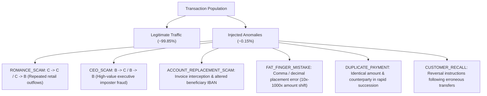
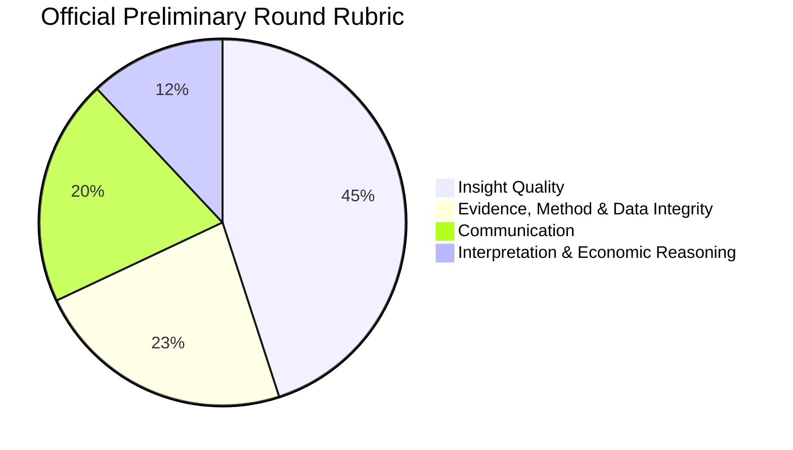

# UMDAC Datathon 2026 – Swift Cross-Border Payments Analytics

Official repository for the **Universiti Malaya Data Analytics Club (UMDAC) Datathon 2026** Preliminary Round challenge in collaboration with **SWIFT**.

---

## 📋 Table of Contents
1. [Competition Overview & Timeline](#competition-overview--timeline)
2. [The Challenge: Reverse-Engineering Swift's Synthetic Payment Engine](#the-challenge-reverse-engineering-swifts-synthetic-payment-engine)
3. [Dataset Architecture & Feature Dictionary](#dataset-architecture--feature-dictionary)
4. [Anomaly & Financial Crime Typologies](#anomaly--financial-crime-typologies)
5. [Preliminary Round Submission Deliverables](#preliminary-round-submission-deliverables)
6. [Official Evaluation Rubric & Scoring Weights](#official-evaluation-rubric--scoring-weights)
7. [Recommended Analytical Strategy & Rule Reconstruction](#recommended-analytical-strategy--rule-reconstruction)
8. [Data Handling & Quickstart Guide](#data-handling--quickstart-guide)
9. [Rules & Compliance](#rules--compliance)

---

## 1. Competition Overview & Timeline

UMDAC Datathon 2026 is an international data analytics competition organised by the Universiti Malaya Data Analytics Club (UMDAC). The competition emphasizes meaningful business insight, reverse-engineering causal mechanisms, and economic interpretability over blind machine learning complexity.

### Critical Milestones
* **Preliminary Round Commencement**: 13 November 2026 at 11:50 AM (UTC+8)
* **Preliminary Round Submission Deadline**: **19 November 2026 at 12:00 PM (UTC+8)** (Strict 144-hour / 6-day sprint)
* **Online Workshop 1**: 17 November 2026 (Tuesday)
* **Finalist Announcement**: 28 November 2026 (Saturday)
* **Online Workshop 2 (Finalists)**: 30 November 2026 (Monday)
* **Grand Final & Closing Ceremony (Physical)**: 4 December 2026 (Friday) at the Faculty of Computer Science and Information Technology (FSKTM), Universiti Malaya, Kuala Lumpur.

---

## 2. The Challenge: Reverse-Engineering Swift's Synthetic Payment Engine

### The Context
Swift interconnects over 11,500 financial institutions, market infrastructures, fintechs, and corporate clients globally. Cross-border payments traversing the Swift network represent directed temporal pseudographs where institutions and customer accounts form nodes, and payment transactions form directed edges with rich transactional features.

Due to strict privacy and regulatory compliance (GDPR, banking secrecy), Swift synthesized this artificial payment dataset by distilling real-world financial dynamics, market behavior, and hard-coded business rules.

### The Objective
Participants must **reverse-engineer the business logic and causal rules** used by Swift to generate the dataset.

> **Key Rule Requirement**:
> Findings must be framed as explicit, testable causal rules rather than simple correlations:
> $$\text{Rule Structure: When [Condition } X\text{], [Target Feature } Y\text{] changes by [Factor } Z\text{] across [Segment } W\text{].}$$

*Note*: Initial baseline properties (e.g., country populations, city geography, and Faker-generated entity names) are randomized for public release. The underlying **economic decision rules, routing behavior, and settlement dynamics** follow rigorous causal logic.

---

## 3. Dataset Architecture & Feature Dictionary

The primary data file is `swift_umdac_datathon_2026_fictitious_payment_data.csv` (1.56 GB compressed ZIP, ~4.95 GB uncompressed CSV, ~10,000,000 records).

### The 21 Features

| # | Feature Name | Data Type | Description & Reverse-Engineering Relevance |
| :---: | :--- | :--- | :--- |
| 1 | `DISCLAIMER` | Text | Legal header / metadata disclaiming liability for fictitious data. |
| 2 | `EPOCH_SECONDS` | Integer | Unix timestamp in seconds. Used to analyze diurnal rhythms, business hours, weekend effects, and clearing cut-offs. |
| 3 | `CURRENCY_CODE` | Categorical | ISO 4217 code (EUR, USD, GBP, CHF, SGD, TRY, CNY, JPY, AUD, CAD, etc.). |
| 4 | `USD_AMOUNT` | Float | Transaction amount normalized to USD for cross-currency equivalence. |
| 5 | `ORDERING_BIC8` | String (8 char) | Sending institution BIC (4 bank + 2 country + 2 location). |
| 6 | `BENEFICIARY_BIC8` | String (8 char) | Receiving institution BIC. |
| 7 | `BIC8_PATH` | String | Semicolon-delimited chain of intermediary routing institutions (e.g., `0024TRI0;0380CNB0`). Gaps marked by `...`. |
| 8 | `TOTAL_DURATION` | Integer | Total elapsed payment settlement time in seconds from initiation to completion. |
| 9 | `CONTINUITY_QFLAG` | Binary (`Y`/`N`) | `Y` if full intermediary path is observable; `N` if route contains hidden intermediaries (`...`). |
| 10 | `CURRENCY_CONVERSION_COUNT` | Integer | Number of FX conversion steps along the routing path (0 = single-currency, $\ge 1$ = FX required). |
| 11 | `PARTICIPANT_COUNT` | Integer | Total number of financial institutions in the settlement path. |
| 12 | `TRANSACTION_TYPE_CODE` | Categorical | Routing mechanism: `Direct` (bilateral), `Indirect` (intermediaries), or `Covered` (MT202COV bank-to-bank settlement). |
| 13 | `ORDERING_ACCOUNT` | String | Anonymized synthetic account ID for the sender (`_FAKE_...`). |
| 14 | `BENEFICIARY_ACCOUNT` | String | Anonymized synthetic account ID for the recipient (`_FAKE_...`). |
| 15 | `ORDERING_DETAILS` | Free-text | Semi-structured remittance party information (name, address, postal code, country code, line breaks). |
| 16 | `ORDERING_TOKENS` | Tokenized Text | Engineered semantic pattern tokens (e.g., `<business:7>`, `<street:18>`, `<post_code:US:5>`, `<line_break:35>`). |
| 17 | `BENEFICIARY_DETAILS` | Free-text | Semi-structured recipient party details and remittance instructions. |
| 18 | `BENEFICIARY_TOKENS` | Tokenized Text | Engineered pattern tokens for beneficiary entity attributes. |
| 19 | `ORDERING_TYPE` | Categorical (`B`/`C`) | Sender classification: `B` (Corporate / Business) vs. `C` (Retail / Consumer). |
| 20 | `BENEFICIARY_TYPE` | Categorical (`B`/`C`) | Recipient classification: `B` (Corporate / Business) vs. `C` (Retail / Consumer). |
| 21 | `ANOMALY_TYPE` | Categorical (Label) | Ground-truth injection flag indicating synthetic fraud or operational errors. |

---

## 4. Anomaly & Financial Crime Typologies

The dataset contains six labeled anomaly categories injected via deterministic programmatic rules:



### Typology Characteristics
1. **ROMANCE_SCAM**:
   * Initiator: Exclusively Consumers (`ORDERING_TYPE = C`).
   * Recipient: Predominantly individual mules (`C`).
   * Amounts: Modest retail payments (mean ~\$4,300 USD), often recurring.
2. **CEO_SCAM (Business Email Compromise)**:
   * Initiator: Exclusively Corporate entities (`ORDERING_TYPE = B`).
   * Recipient: Uncharacteristic retail or money mule accounts (`C`).
   * Amounts: Extreme transaction values (mean > \$2,200,000 USD, up to \$17M USD).
3. **ACCOUNT_REPLACEMENT_SCAM (Vendor Invoice Fraud)**:
   * Legitimate B2B invoice hijacked; beneficiary account substituted for an unverified recipient.
4. **FAT_FINGER_MISTAKE**:
   * Data entry typo shifting decimal point (e.g., 500.00 entered as 50000.00). Generates extreme statistical outliers (amounts reaching into hundreds of millions or billions of USD).
5. **DUPLICATE_PAYMENT**:
   * Exact matching tuples `(ORDERING_ACCOUNT, BENEFICIARY_ACCOUNT, USD_AMOUNT)` executed within a tight time window ($\Delta t \approx 0$).
6. **CUSTOMER_RECALL**:
   * Formal SWIFT gpi / MT192 stop-payment and recall requests.

---

## 5. Preliminary Round Submission Deliverables

Participants must submit **two standalone PDF files** before **19 November 2026, 12:00 PM**:

### Deliverable 1: Dashboard Suite (PDF Format)
* **Scope**: 5 to 15 dashboard pages (one page per feature group).
* **Content**:
  * Clearly stated reconstructed business rule for each insight.
  * At least one primary chart demonstrating how the rule is reflected in the data.
  * Baseline or comparison group benchmarks.
* **Evaluation Criteria**: Visual Clarity (35%), Effectiveness of Charts & Evidence (50%), Correctness of Insights (15%).

### Deliverable 2: Presentation Slide Deck (PDF Format)
* **Scope**: 10 to 20 slides total (including Title and Methodology).
* **Constraint**: **Maximum of 1 slide per feature-type group**.
* **Content**:
  * Formal restatement of reconstructed rules.
  * Supporting charts extracted or referenced from the dashboard.
  * Real-world economic behavior & correspondent banking mechanics explaining each rule.
  * Step-by-step analytical methodology and counterfactual validation.
* **Evaluation Criteria**: Methodology & Analytical Process (65%), Economic Explanations (20%), Overall Presentation Quality (15%).

---

## 6. Official Evaluation Rubric & Scoring Weights

Across both deliverables, marks are distributed across four main pillars:



### Deep Dive into Rubric Sub-Criteria

| Category | Weight | Sub-Criterion | Scoring Focus |
| :--- | :---: | :--- | :--- |
| **Insight Quality** | **45%** | Task understanding (5%) | Formulates specific, testable causal hypotheses. |
| | | Rule reconstruction quality (12%) | Explicit preconditions, magnitude of change, and segment coverage. |
| | | Explanatory depth (14%) | Separates causality from correlation; **reports rejected hypotheses**. |
| | | Specificity of finding (5%) | Concise, quantified one-sentence headline per insight. |
| | | Correctness of rules (9%) | Accuracy against Swift's true generator script. |
| **Evidence & Integrity**| **23%** | Empirical proof (6%) | Statistically sound baseline comparisons and confidence intervals. |
| | | Data integrity (6%) | Transparent data transformations; zero data leakage. |
| | | Method appropriateness (8%) | Suitability of analytical technique. (Avoid unneeded complexity). |
| | | Responsible data use (3%) | Strict use of provided data; proper APA citations for reference metrics. |
| **Communication** | **20%** | Narrative structure (6%) | Headline-first presentation flow leading to clear conclusions. |
| | | Dashboard quality (8%) | Self-explanatory visualizations with annotations and baselines. |
| | | Visual clarity (6%) | Clean design, zero clutter, honest axes, and focused takeaways. |
| **Economic Reasoning**| **12%** | Plausibility (6%) | Grounded in correspondent banking, RTGS, and market dynamics. |
| | | Scope & limits (6%) | Identifies boundaries between synthetic noise and causal rules. |

---

## 7. Recommended Analytical Strategy & Rule Reconstruction

### 8 Candidate Feature Groups (One per Dashboard & Slide)
1. **Monetary Sizing & Distribution**: Sizing distributions across $B \to B$ vs. $C \to C$; log-normal modeling; Benford's Law analysis.
2. **Temporal & Settlement Latency**: `TOTAL_DURATION` modeling conditioned on local bank business hours, weekend gaps, and RTGS clearing cut-offs.
3. **Routing Architecture & Topology**: Decision logic choosing `Direct`, `Indirect`, or `Covered` routing based on jurisdiction and clearing corridors.
4. **Foreign Exchange & Corridors**: Corridors requiring `CURRENCY_CONVERSION_COUNT \ge 1` and intermediary FX clearing hubs.
5. **Counterparty Interaction Dynamics**: Transaction matrices ($B \to B$, $B \to C$, $C \to B$, $C \to C$) and volume ratios.
6. **Tokenized Text & Remittance Fields**: Regex token structure analysis (`ORDERING_TOKENS`, IBAN compliance, character entropy).
7. **Path Continuity & Intermediary Obfuscation**: Root-cause triggers for `CONTINUITY_QFLAG = N` (unobserved intermediary hops `...`).
8. **Financial Crime & Anomaly Engine**: Quantitative decision boundaries separating normal traffic from CEO Scams, Romance Scams, and Typo Errors.

---

## 8. Data Handling & Quickstart Guide

Because the uncompressed CSV is 4.95 GB, avoid loading the entire dataset into memory at once with standard `pandas.read_csv()`. Instead, use **Polars** (lazy execution) or **DuckDB**.

### High-Performance Python Example (Polars)
```python
import polars as pl

# Connect via LazyFrame without loading 5GB into memory
lazy_df = pl.scan_csv("swift_umdac_datathon_2026_fictitious_payment_data.csv")

# Compute anomaly profiling across counterparty archetypes
anomaly_profile = (
    lazy_df
    .filter(pl.col("ANOMALY_TYPE") != "")
    .group_by(["ANOMALY_TYPE", "ORDERING_TYPE", "BENEFICIARY_TYPE"])
    .agg([
        pl.count().alias("count"),
        pl.col("USD_AMOUNT").mean().alias("mean_usd"),
        pl.col("USD_AMOUNT").median().alias("median_usd"),
        pl.col("TOTAL_DURATION").mean().alias("mean_duration_sec")
    ])
    .collect()
)

print(anomaly_profile)
```

---

## 9. Rules & Compliance

* **Primary Data Exclusivity**: You must **only** use the provided Swift dataset for primary analysis. External datasets are strictly prohibited.
* **External Reference Statistics**: Credible external statistics (e.g., World Bank, BIS, IMF, SWIFT public reports) are allowed **solely to calibrate and benchmark findings**, provided they are cited in **APA format** with active hyperlinks.
* **AI Tool Usage**: LLMs and AI coding assistants (ChatGPT, Claude, Gemini, etc.) are **explicitly permitted**. No separate declaration is needed, but participants must understand, explain, and defend all submitted methodologies and results.

---

*Repository maintained for UMDAC Datathon 2026 participation.*
